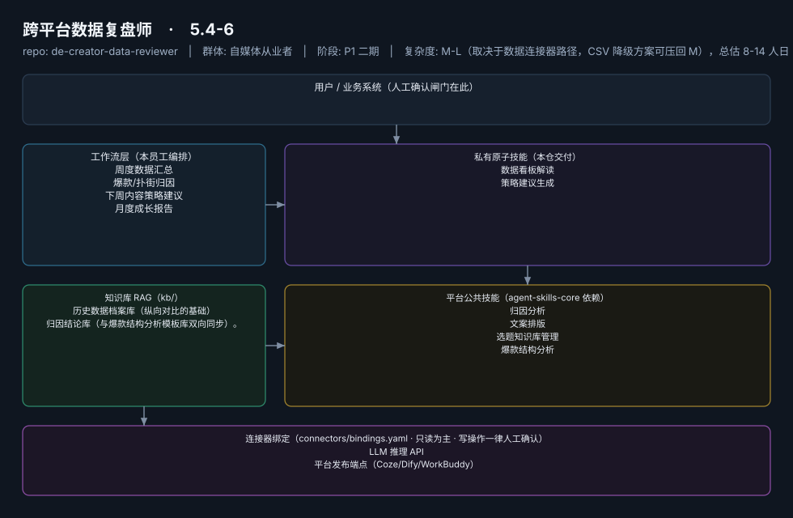

# 跨平台数据复盘师

> 把割裂的各平台后台归一成一张看得懂、能指导下周选题的复盘报告
>
> **5.4-6**　·　自媒体从业者　·　阶段 P1 二期　·　
> 复杂度 M-L（取决于数据连接器路径，CSV 降级方案可压回 M），总估 8-14 人日　·　¥50-100/月（据 R2 调研，V3 报告四星）　·　定义卡 5.4-6



**一句话**：中腰部以上创作者（多平台运营、有复盘意识但无方法的人群）

---

## 这个数字员工解决什么问题

把割裂的各平台后台归一成一张看得懂、能指导下周选题的复盘报告

| 项 | 内容 |
|---|---|
| 服务对象 | 中腰部以上创作者（多平台运营、有复盘意识但无方法的人群） |
| 可量化目标 | 复盘环节执行率从"多数人跳过"（据 R2 调研）提升至 ≥80%；复盘→选题回写率 100%（每条策略建议必须落进选题库） |
| 投入产出 | 直接月省约 12h 折 ¥360-480；闭环收口的选题质量提升为主要价值 |
| 需求依据 | D19、D11、D02 |
| 分发渠道 | GitHub（必备基础渠道）、千问办公、腾讯WorkBuddy Skill市场、Dify Marketplace、小红书 |

## 30 秒上手

```bash
git clone <本仓库地址> && cd de-creator-data-reviewer
pip install pyyaml
python3 tests/run.py            # 先跑一遍自检，确认环境与契约都对得上
```

试用（把 `<输入>` 换成本人真实材料）：

```text
请以「跨平台数据复盘师」的身份，帮我跑「周度数据汇总」。
材料如下：<输入>
要求：只使用材料里出现过的数字，缺的写 <待填>；对外文案停在待确认状态。
```

详细接入见 [`docs/01-安装与接入.md`](docs/01-安装与接入.md)。

## 仓库结构

```text
de-creator-data-reviewer/
├── employee.yaml          # 机器契约（能力清单 + 依赖锁）
├── dependencies.yaml      # 对 core 的外部依赖（含版本）
├── persona/               # 运行提示词 / 边界 / KPI
├── skills/                # 私有原子技能（2 个）
├── spec-bindings/         # 有意不公共化能力的本地绑定声明（0 个）
├── workflows/             # 本员工工作流（4 条）
├── kb/                    # 知识库 RAG 契约
├── connectors/            # 连接器绑定（只读为主，写操作人工确认）
├── docs/                  # 六类发布文档
└── tests/                 # 自动化多场景测试
```

## 私有原子技能（2）

| 技能 | slug | 复杂度 | 阶段 | 成熟度 |
|---|---|---|---|---|
| `数据看板解读` | `dashboard-interpretation` | M | P1 | 契约完备 |
| `策略建议生成` | `strategy-recommendation` | S | P1 | 契约完备 |

## 平台公共技能依赖（4）

| 技能 | slug | 全平台复用员工数 |
|---|---|---|
| `归因分析` | `attribution-analysis` | 4 |
| `文案排版` | `copy-layout` | 2 |
| `选题知识库管理` | `topic-kb-manage` | 3 |
| `爆款结构分析` | `viral-structure-analysis` | 2 |

> 这些技能来自 `agent-skills-core@1.0.0`，本仓库**只引用不复制**。

## Spec 绑定层（0）

（无）

> 这一族能力**有意不公共化**（与外部平台接口强绑定）。本仓不存正文，
> 只留本地绑定声明与连接器配置。

## 工作流（4）

| 工作流 | slug | 触发 | 阶段 | 调用技能数 |
|---|---|---|---|---|
| `周度数据汇总` | `wf-creator-review-data-merge` | 定时（每周日） | P1 | 1 |
| `爆款/扑街归因` | `wf-creator-review-attribution` | 事件（WF1 后自动） | P1 | 2 |
| `下周内容策略建议` | `wf-creator-review-strategy` | 事件（WF2 后自动） | P1 | 2 |
| `月度成长报告` | `wf-creator-review-monthly-report` | 定时（每月 1 日） | P2 | 1 |

## 知识库与连接器

- 知识库语料：['历史数据档案库（纵向对比的基础）', '归因结论库（与爆款结构分析模板库双向同步）。']
- 连接器：LLM 推理 API、平台发布端点（Coze/Dify/WorkBuddy）

## 质量与验收

| 项 | 值 |
|---|---|
| 技能文件数 | 72 |
| 多场景用例数 | 185 |
| 用例通过 | 185 |
| 验收结论 | ✅ 通过 |

完整报告：[`docs/05-验收与测试.md`](docs/05-验收与测试.md)

## 许可

专有许可，详见 [`LICENSE`](LICENSE)。
