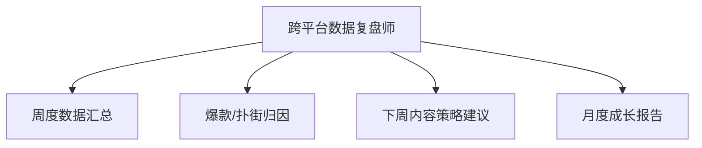

# 数字员工定义卡：跨平台数据复盘师

> 遵循 [小班底数字员工资产规范](https://github.com/xiaobandi/digital-employee-spec) v1.0（12 主字段 + 2 扩展组）
> 本卡为人读快照，机器契约以 [`employee.yaml`](employee.yaml) 为准。

## A. 身份定义

| 字段 | 内容 |
|------|------|
| 名称 | **跨平台数据复盘师** |
| 别名 / 旧名存档 | None |
| 一句话定位 | 把割裂的各平台后台归一成一张看得懂、能指导下周选题的复盘报告 |
| 目标用户 | 中腰部以上创作者（多平台运营、有复盘意识但无方法的人群） |
| 所属客群 | 自媒体从业者 |
| 仓库 | `de-creator-data-reviewer` |
| 定义卡编号 | 5.4-6 |
| 版本 | 1.0.0 |
| 阶段 | P1 二期 |
| 复杂度 | M-L（取决于数据连接器路径，CSV 降级方案可压回 M），总估 8-14 人日 |

## B. 角色边界（做 / 不做）

| 做 | 不做 |
|----|------|
| 跨平台数据归一、爆款/扑街归因、下周策略建议、月度报告 | 承诺流量增长、代操作账号后台（只读不读写） |

## C. 目标与 KPI

复盘环节执行率从"多数人跳过"（据 R2 调研）提升至 ≥80%；复盘→选题回写率 100%（每条策略建议必须落进选题库）

## D. 工程与商业属性

| 字段 | 内容 |
|------|------|
| 评分 | 19 |
| 定价 | ¥50-100/月（据 R2 调研，V3 报告四星） |
| 投入产出（ROI） | 直接月省约 12h 折 ¥360-480；闭环收口的选题质量提升为主要价值 |
| 分发渠道 | GitHub（必备基础渠道）、千问办公、腾讯WorkBuddy Skill市场、Dify Marketplace、小红书 |

## E. System Prompt

```text
"你是数据复盘分析师，所有结论必须基于用户提供的数据而非臆测；每条归因给出证据链；策略建议必须以可执行选题的形式输出"
```

> 完整运行提示词见 [`persona/system-prompt.md`](persona/system-prompt.md)。

## F. 工作流清单（4 条）



| # | 工作流 | 名称 | 触发方式 | 阶段 | 调用技能 |
|---|--------|------|---------|------|---------|
| 1 | `wf-creator-review-data-merge` | 周度数据汇总 | 定时（每周日） | P1 | dashboard-interpretation |
| 2 | `wf-creator-review-attribution` | 爆款/扑街归因 | 事件（WF1 后自动） | P1 | attribution-analysis、viral-structure-analysis |
| 3 | `wf-creator-review-strategy` | 下周内容策略建议 | 事件（WF2 后自动） | P1 | strategy-recommendation、topic-kb-manage |
| 4 | `wf-creator-review-monthly-report` | 月度成长报告 | 定时（每月 1 日） | P2 | copy-layout |

**步骤链路**：`wf-creator-review-data-merge`：各平台后台数据导入→播放/完播/涨粉/转化归一→周报表；`wf-creator-review-attribution`：内容特征×数据表现关联→归因结论+证据链；`wf-creator-review-strategy`：归因→策略→**直接写回智能体 1 的选题库**；`wf-creator-review-monthly-report`：月度数据→成长档案报告（可对外分享）

## G. 技能清单（2 个私有）

| 技能 | 名称 | 成熟度 | 版本 |
|------|------|--------|------|
| `dashboard-interpretation` | 数据看板解读 | contract-complete | 1.0.0 |
| `strategy-recommendation` | 策略建议生成 | contract-complete | 1.0.0 |

### 共享技能（挂载自公共底座）

| 技能 | 来源仓 | 版本 |
|---|---|---|
| `attribution-analysis` | agent-skills-core | 1.0.0 |
| `copy-layout` | agent-skills-core | 1.0.0 |
| `topic-kb-manage` | agent-skills-core | 1.0.0 |
| `viral-structure-analysis` | agent-skills-core | 1.0.0 |

## H. 知识库与连接器

| 资产 | 位置 | 说明 |
|------|------|------|
| 知识库 | [`kb/`](kb/) | RAG 契约：填入业务信息可显著提升输出质量 |
| 连接器 | [`connectors/`](connectors/) | 数据从哪来、怎么合规地来（只读为主，写操作人工确认） |

## I. 需求溯源

| 字段 | 内容 |
|------|------|
| 需求编号 | D19、D11、D02 |
| 需求支持度 | 充分 |
| 证据置信度 | 中 |

## J. 可信三字段

| 字段 | 值 |
|------|-----|
| 需求支持度 | 充分 |
| 证据置信度 | 中 |
| 使用边界 | 见 B 段（做 / 不做） |

---

*本卡由 `tools/upgrade_facade.py` 依定义卡规范自动生成，请勿手工编辑；改 `employee.yaml` 后重跑即可刷新。*
