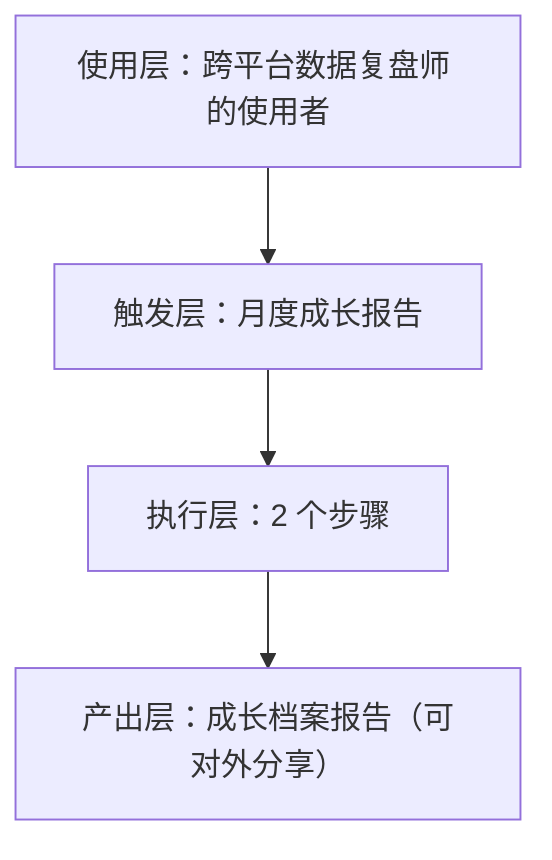
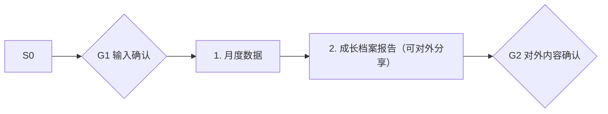

# 月度成长报告 · 架构与流程图

## 本工作流的四层结构

| 层 | 内容 |
|---|---|
| 使用层 | 中腰部以上创作者（多平台运营、有复盘意识但无方法的人群）；员工定位：把割裂的各平台后台归一成一张看得懂、能指导下周选题的复盘报告 |
| 触发层 | 关键词 / 显式点名「月度成长报告」；触发方式：定时（每月 1 日） |
| 执行层 | 月度数据 → 成长档案报告（可对外分享） |
| 产出层 | 成长档案报告（可对外分享） |

## 执行流程

## 步骤职责表

| # | 步骤 | 承担者 | 为什么 |
|---|---|---|---|
| 1 | 月度数据 | 模型 | 需要读懂语境，不可用固定规则替代 |
| 2 | 成长档案报告（可对外分享） | 模型 | 需要读懂语境，不可用固定规则替代 |

⚠️ 尚未补齐：图中的步骤来自注册表口径，未逐条实跑校验；实跑后请同步修订本页（`发布标准.md` 第六项：通读一遍，不得出现重复填充句）。
